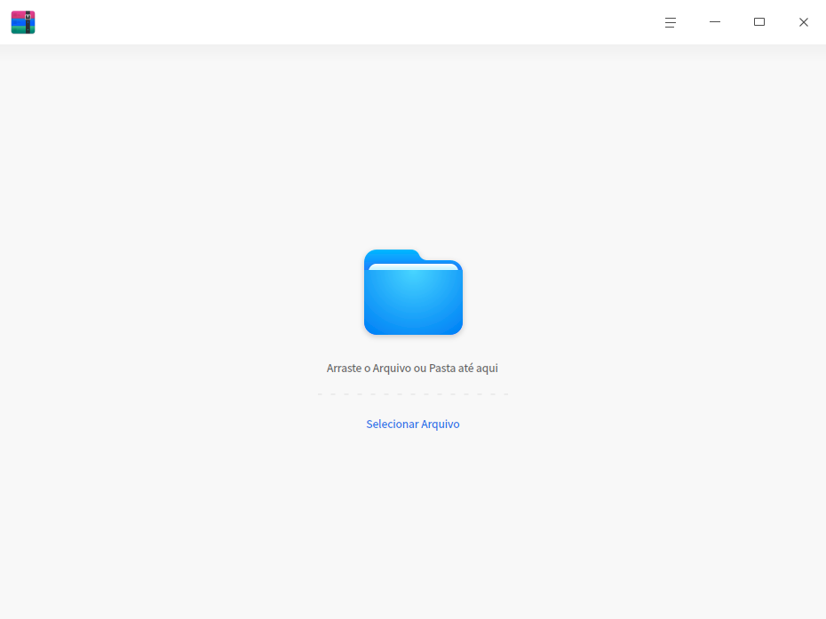
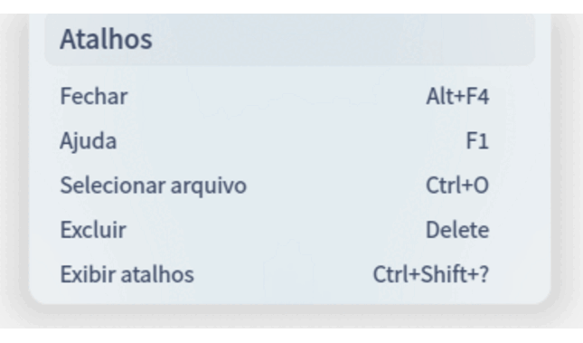
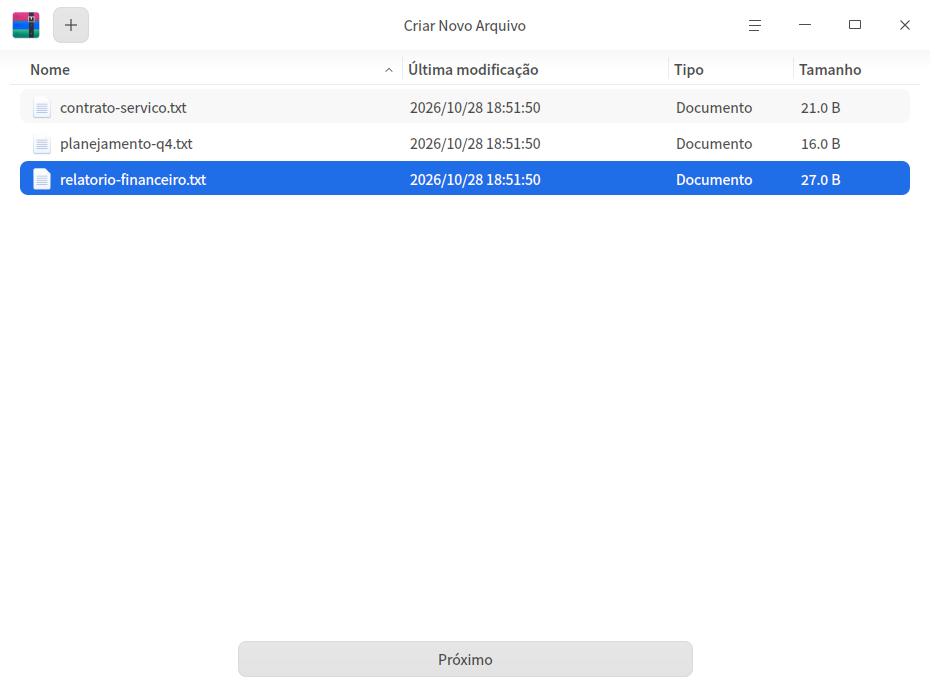
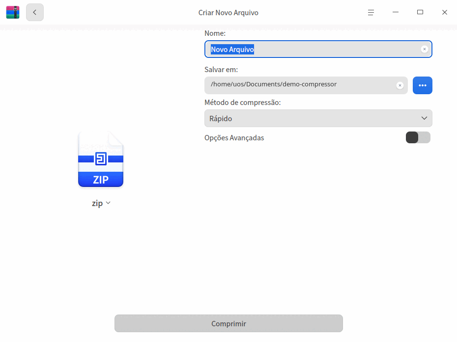
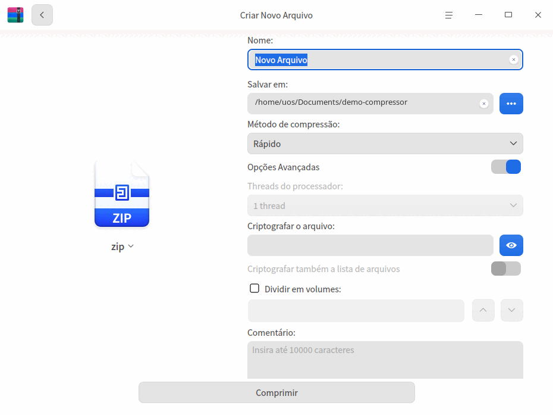
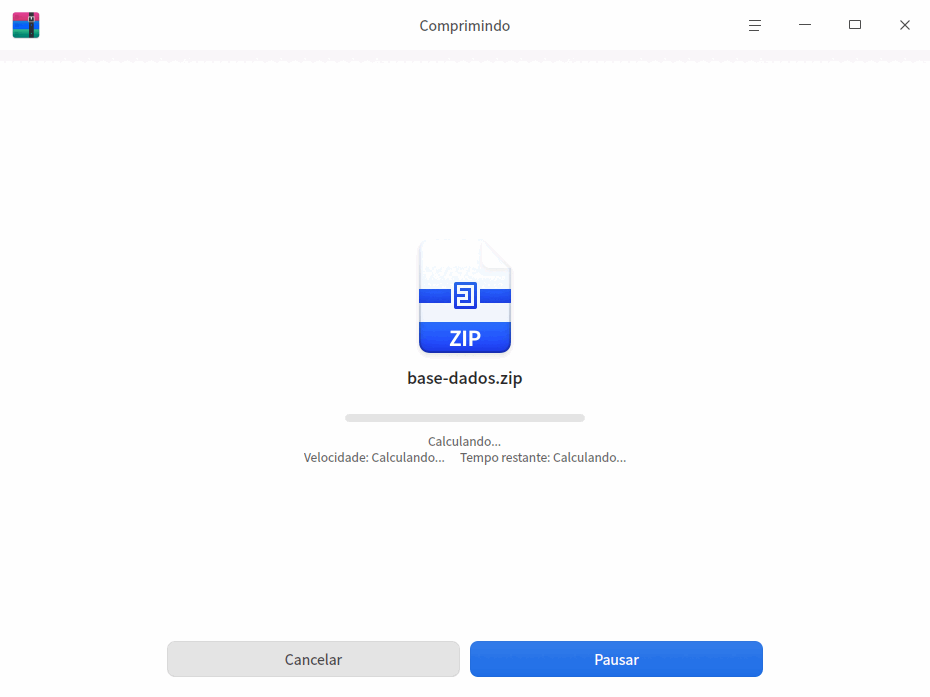
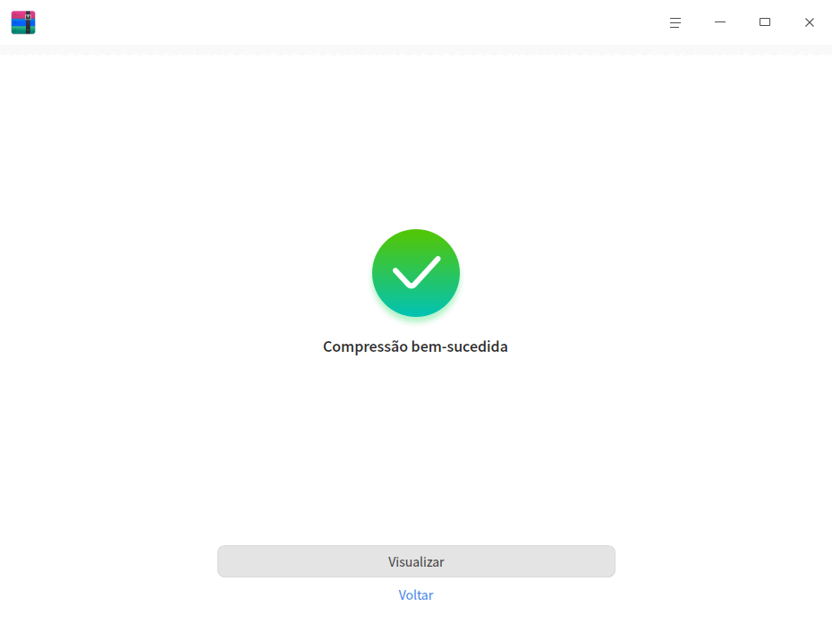
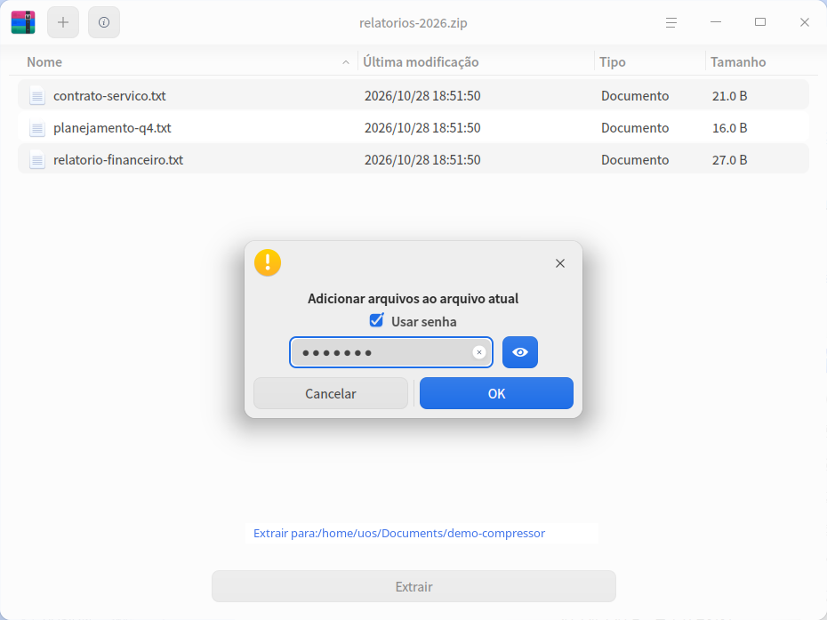
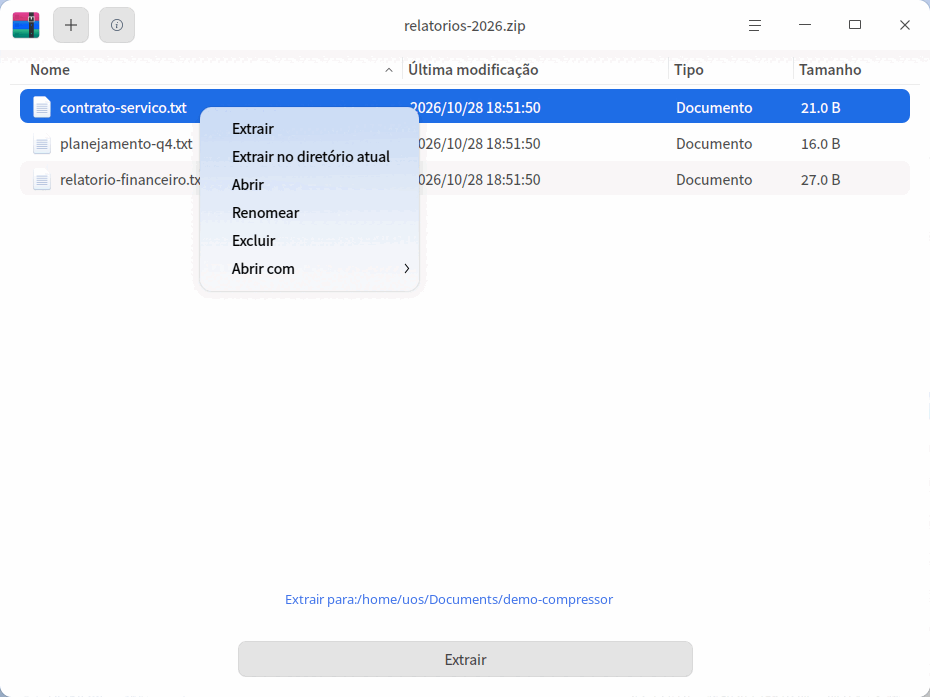

# Gerenciador de Compactação|deepin-compressor|

## Visão geral

O Gerenciador de Compactação é um software de compressão e descompressão com interface amigável e fácil de usar. Ele suporta vários formatos de arquivo compactado, como 7z, jar, tar, tar.bz2, tar.gz, tar.lz, tar.lzma, tar.lzo, tar.xz, tar.Z, tar.7z e zip, além de recursos como compactação com várias senhas, compactação em volumes e inclusão de comentários.

## Introdução

Use as formas abaixo para iniciar ou encerrar o Gerenciador de Compactação, ou para criar um atalho para ele.

### Iniciar o Gerenciador de Compactação

1. Clique no ícone do lançador  na barra de tarefas para entrar na interface do lançador.
2. Role a roda do mouse para navegar ou use a pesquisa para localizar o ícone do Gerenciador de Compactação  e clique nele para iniciar.
3. Clique com o botão direito em  para:
 - Clicar em **Enviar para a área de trabalho** e criar um atalho na área de trabalho.
 - Clicar em **Enviar para a barra de tarefas** e fixar o aplicativo na barra de tarefas.
 - Clicar em **Iniciar automaticamente** e adicionar o aplicativo aos itens de inicialização, para que ele seja executado automaticamente ao ligar o computador.

### Encerrar o Gerenciador de Compactação

- Na interface do Gerenciador de Compactação, clique em  para sair do Gerenciador de Compactação.
- Na barra de tarefas, clique com o botão direito em  e selecione **Fechar tudo** para sair do Gerenciador de Compactação.
- Na interface do Gerenciador de Compactação, clique em  e selecione **Sair** para sair do Gerenciador de Compactação.

### Exibir atalhos

Na interface do Gerenciador de Compactação, use o atalho **Ctrl + Shift + ?** para abrir a interface de visualização de atalhos. Dominar os atalhos aumenta bastante sua produtividade.

## Guia de operações

Na interface do Gerenciador de Compactação, você pode compactar ou descompactar um ou vários arquivos (pastas), e pode operar em várias janelas ao mesmo tempo.

### Compactar
1. Selecione os arquivos a compactar.

   + Clique com o botão direito no arquivo (pasta) a compactar e selecione **Comprimir**.
   + Arraste os arquivos diretamente para a interface do Gerenciador de Compactação e clique em **Próximo**.
      - Clique no botão adicionar  no canto superior esquerdo ou em  > **Abrir arquivo** para continuar adicionando arquivos (pastas) a compactar.
      - Na lista de arquivos do Gerenciador de Compactação, clique com o botão direito em um arquivo (pasta) para visualizá-lo ou excluí-lo.

   

2. Na interface de compactação, defina o nome do arquivo, o caminho de armazenamento, o método de compressão e outras informações.
   >  Observação: o formato padrão do arquivo compactado é zip.

   
   
   

<table border="1">
   <tr>
    <th>Nome</th>
 <th>Descrição </th>
</tr>
   <tr>
    <td>Método de compressão</td>
    <td>As opções de método de compressão são Armazenar, Mais rápido, Rápido, Normal, Bom e Melhor.
      <ul>
          <li>Armazenar: apenas agrupa os arquivos, sem aplicar compressão.</li>
          <li>Mais rápido, Rápido, Normal, Bom e Melhor: aumentam gradualmente a taxa de compressão. Quanto maior a taxa, mais tempo leva para compactar o mesmo arquivo.</li>
      </ul>
 </td>
</tr>
   <tr>
    <td>Opções Avançadas</td>
    <td>Depois de ativar as opções avançadas, você pode definir criptografia, compactação em volumes, comentários e outros itens para os arquivos/lista de arquivos.
    <ul>
          <li>Threads do processador: inclui thread única, duas threads, quatro threads e oito threads. Quanto mais threads, mais rápida a compactação. Suportado apenas no formato tar.gz.</li>
          <li>Criptografar o arquivo: criptografa os arquivos, sendo necessário informar a senha para ver o conteúdo. Suporta os formatos 7z, tar.7z e zip. É possível usar números, letras, símbolos ou caracteres comuns para a criptografia.</li>
          <li>Criptografar também a lista de arquivos: criptografa a lista de arquivos, sendo necessário informar a senha para ver as informações da lista. Suporta os formatos 7z e tar.7z. A criptografia da lista e a dos arquivos usam a mesma senha.</li>
          <li>Dividir em volumes: divide arquivos grandes em volumes para facilitar o transporte. O arquivo pode ser dividido em vários volumes compactados, com suporte a até 200 volumes, nos formatos 7z e zip.</li>
          <li>Comentário: adiciona um comentário ao arquivo compactado. Suportado apenas no formato zip.</li>
      </ul>
 </td>
   </tr>
   </table>

3. Clique em **Comprimir**. Durante a compactação, é possível pausar/continuar a operação.

   

4. Após a compactação ser concluída com sucesso, você pode:
   - Clicar em **Visualizar** para ver onde o arquivo compactado foi salvo.
   - Clicar em **Voltar** para retornar à interface principal e selecionar arquivos para compactar.
   
   

### Descompactar

1. Selecione o arquivo compactado.

   + Clique com o botão direito no arquivo compactado e selecione **Extrair**.
   + Arraste o arquivo compactado diretamente para a interface do Gerenciador de Compactação.
      - Adicionar e criptografar arquivos: clique no botão adicionar  no canto superior esquerdo ou em  > **Abrir arquivo** para adicionar arquivos ao pacote compactado. Na caixa de diálogo exibida, marque "Usar senha" e defina uma senha para criptografar os arquivos. Arquivos diferentes podem ter senhas diferentes; apenas pacotes no formato zip suportam criptografar os arquivos adicionados.
      
      

      - Visualizar informações: clique no ícone  na barra de menus para ver as informações do arquivo e o conteúdo do comentário. Apenas pacotes no formato zip suportam editar novamente o comentário.

2. Na interface de descompactação, é possível definir o caminho, extrair arquivos e realizar outras operações.
   - Definir o caminho de armazenamento: clique em **Extrair para: xxx (caminho)** e escolha o caminho de armazenamento na janela exibida.
   - Extrair arquivos: na lista de arquivos, clique com o botão direito em um arquivo (pasta) e selecione **Extrair** ou **Extrair no diretório atual** para extrair o arquivo (pasta) para o caminho correspondente.
   - Visualizar ou excluir arquivos: na lista de arquivos, clique com o botão direito em um arquivo (pasta) e selecione **Abrir** para visualizá-lo ou **Excluir** para removê-lo da lista.

   

3. Clique em **Extrair**. Durante a descompactação, é possível pausar/continuar a operação.

   >  Observação: quando o pacote compactado contém arquivos criptografados, é necessário informar a senha para descompactar. Quando há vários arquivos criptografados, é necessário informar as senhas uma a uma.

4. Após a descompactação ser concluída com sucesso, você pode:
   - Clicar em **Visualizar** para ver onde os arquivos extraídos foram salvos.
   - Clicar em **Voltar** para retornar à interface principal e selecionar pacotes compactados para descompactar.

   

## Menu principal

No menu principal, você pode abrir arquivos, alterar configurações, trocar o tema da janela, consultar o manual de ajuda e saber mais sobre o Gerenciador de Compactação.

### Abrir
1. Na interface do Gerenciador de Compactação, clique em  .
2. Selecione **Abrir arquivo** e escolha o arquivo a compactar ou o pacote compactado.

### Configurações

1. Na interface do Gerenciador de Compactação, clique em  .
2. Selecione **Configurações** e realize as operações abaixo:
   - Configurações de descompactação
     + Defina o local padrão de descompactação. É possível escolher o diretório atual, a área de trabalho ou outro diretório.
     + Marque ou desmarque **Criar pasta automaticamente**.
     + Marque ou desmarque **Abrir a pasta correspondente automaticamente após a descompactação**.
   - Configurações de gerenciamento de arquivos
     + Defina se deve **Excluir o arquivo compactado após a descompactação**, escolhendo "Nunca", "Perguntar" ou "Sempre".
     + Marque ou desmarque **Excluir os arquivos originais após a compactação**.
   - Configurações de associação de arquivos
     + Marque ou desmarque os tipos de arquivo associados. Por padrão, todos ficam marcados.
3. Clique em **Restaurar padrão** para redefinir todas as configurações ao estado inicial.

### Tema

Os temas de janela incluem tema claro, tema escuro e tema do sistema.

1. Na interface do Gerenciador de Compactação, clique em .
2. Selecione **Tema** e escolha uma cor de tema.

### Ajuda

Consulte o manual de ajuda para conhecer e usar melhor o Gerenciador de Compactação.

1. Na interface do Gerenciador de Compactação, clique em .
2. Selecione **Ajuda**.
3. Consulte o manual de ajuda do Gerenciador de Compactação.

### Sobre

1. Na interface do Gerenciador de Compactação, clique em .
2. Selecione **Sobre**.
3. Consulte a versão e a apresentação do Gerenciador de Compactação.

### Sair

1. Na interface do Gerenciador de Compactação, clique em .
2. Selecione **Sair**.
